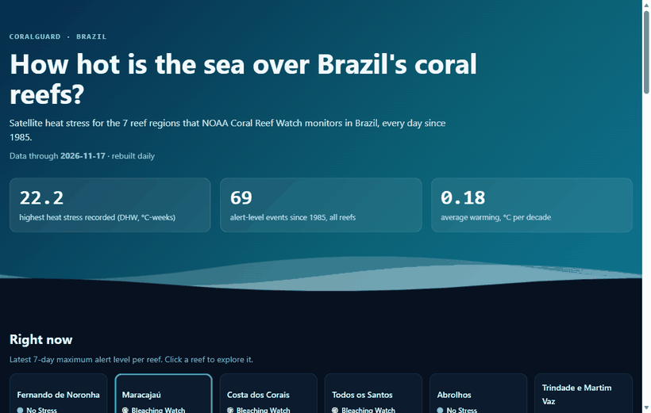
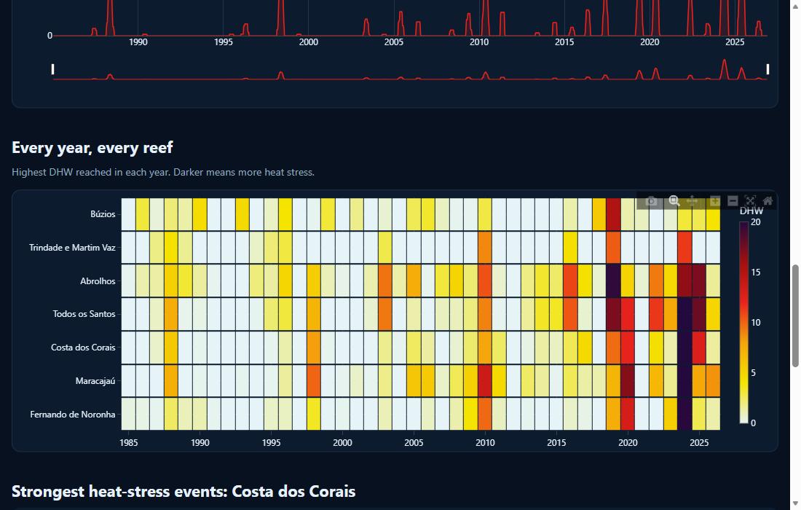
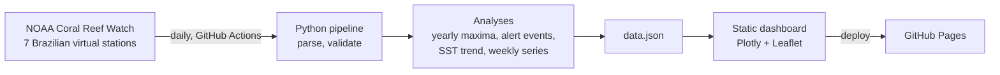

# CoralGuard

[Português](README.md) · **English**

Satellite heat stress for the 7 reef regions that NOAA Coral Reef Watch monitors in Brazil, daily since 1985,
served as an interactive dashboard that is rebuilt automatically every day.

**Live dashboard: [hnryguchi.github.io/CoralGuard](https://hnryguchi.github.io/CoralGuard/)**

[](https://github.com/hnryguchi/CoralGuard/actions/workflows/pages.yml)
[](https://github.com/hnryguchi/CoralGuard/actions/workflows/ci.yml)



## What the data shows

Values computed by this pipeline from NOAA CRW data through 2026-11-17:

| Reef region | Worst year (max DHW, °C-weeks) | Alert-level events since 1985 | Sea surface temperature trend |
|---|---|---|---|
| Maracajaú | 2024 (22.2) | 15 | +0.21 °C / decade |
| Costa dos Corais | 2024 (21.4) | 10 | +0.22 °C / decade |
| Todos os Santos | 2024 (20.9) | 12 | +0.28 °C / decade |
| Fernando de Noronha | 2024 (19.8) | 5 | +0.19 °C / decade |
| Abrolhos | 2019 (19.6) | 16 | +0.22 °C / decade |
| Búzios | 2019 (15.1) | 6 | +0.05 °C / decade |
| Trindade e Martim Vaz | 2024 (11.3) | 5 | +0.10 °C / decade |

- **2024 was the worst year on record** for five of the seven regions, in line with the fourth global coral bleaching event declared by NOAA.
- Three regions crossed **20 °C-weeks**, the threshold of CRW's highest level (Alert Level 5, risk of near-complete coral mortality).
- Every region warmed between 1985 and 2025.



## Current status and map

<a href="https://hnryguchi.github.io/CoralGuard/"></a>

This card is regenerated with the dashboard every day. [`reefs.geojson`](reefs.geojson) opens as an interactive
map on GitHub: click a reef to see its worst year, alert events and warming trend (snapshot of the data through
2026-11-17; the daily build publishes a fresh copy at
[hnryguchi.github.io/CoralGuard/reefs.geojson](https://hnryguchi.github.io/CoralGuard/reefs.geojson)).

## How it works



- **Pipeline** (`src/coralguard`, pandas/numpy):
  - parses CRW Regional Virtual Station files (header metadata and daily table);
  - computes yearly maximum Degree Heating Weeks (DHW), days at Alert Level 1 or above, and alert events (consecutive alert days, merged across gaps of up to 7 days);
  - fits a linear trend of annual mean SST over complete years;
  - writes weekly maxima to keep the browser payload small.
- **Dashboard** (`src/coralguard/site/`):
  - static HTML/CSS/JS: live status cards, a map, the DHW time series with CRW alert thresholds and a range slider, a year-by-reef heatmap and an events table;
  - animations respect `prefers-reduced-motion`.
- **Automation:** `.github/workflows/pages.yml` downloads fresh data, rebuilds and deploys every day. CI runs lint and tests on every push. GitHub pauses scheduled workflows in repositories with no activity for 60 days; the badge above shows the last run.

## Scope and limitations

- DHW and Bleaching Alert Area are **satellite-derived heat-stress indicators that predict bleaching risk**. They are not field observations of bleaching. Confirming bleaching needs in-water surveys.
- Each station summarises a regional polygon using CRW's 90th-percentile HotSpot method. Local conditions within a reef can differ.
- SST trends are simple linear fits on annual means, a descriptive summary rather than a formal climate attribution.

## Run locally

```bash
python -m venv .venv && . .venv/bin/activate     # Windows: .venv\Scripts\activate
pip install -e ".[dev]"
coralguard summary                                # text summary per reef (downloads ~7 MB)
coralguard build --out dist && python -m http.server -d dist 8000
pytest -q && ruff check src tests
```

## Project history

This repository was created in **October 2025**, under the author's previous account, as a small pandas script with a three-line **fictitious** sample dataset. In November 2026 it was migrated to this account with its full history; GitHub therefore shows 2026 as the creation date, while the commits keep their original dates.
In November 2026 it was rebuilt on real NOAA data: the fictitious data was removed, and the pipeline,
tests, dashboard and daily deployment were added. The old commits are kept for transparency.

## Data and license

- Data: NOAA Coral Reef Watch. 2018, updated daily. *NOAA Coral Reef Watch Version 3.1 Daily Global 5km Satellite Coral Bleaching Heat Stress Monitoring Product Suite*, Regional Virtual Stations. College Park, Maryland, USA: NOAA Coral Reef Watch. Public domain. Tests use a real excerpt (Abrolhos, 2019 and Oct–Nov 2026).
- Map tiles © OpenStreetMap contributors.
- Code: MIT © Henry Noguchi.
