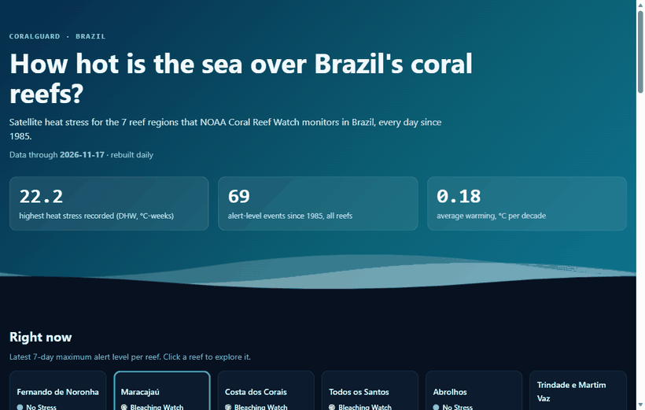
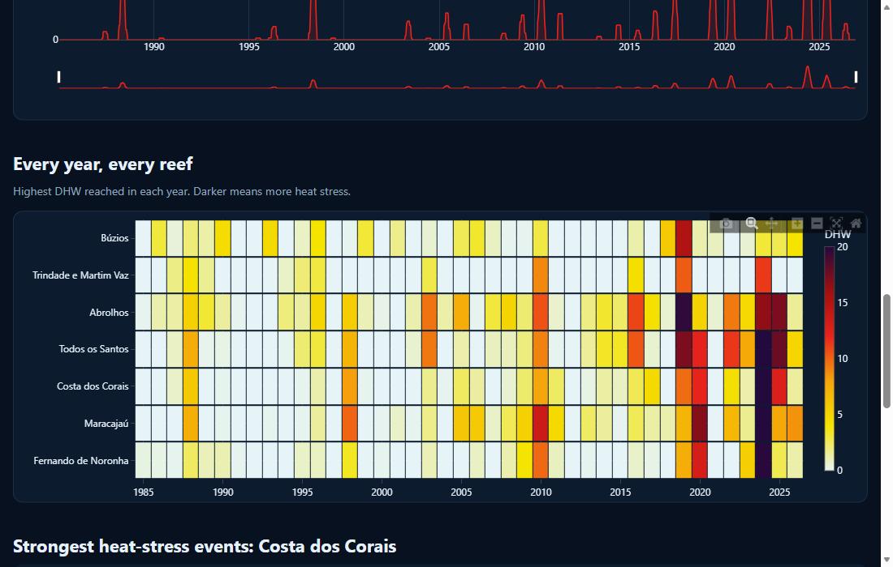
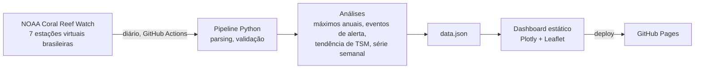

# CoralGuard

**Português** · [English](README.en.md)

Estresse térmico por satélite nas 7 regiões recifais que o NOAA Coral Reef Watch monitora no Brasil, com série
diária desde 1985, publicado como dashboard interativo reconstruído automaticamente todos os dias.

**Dashboard ao vivo: [hnryguchi.github.io/CoralGuard](https://hnryguchi.github.io/CoralGuard/)**

[](https://github.com/hnryguchi/CoralGuard/actions/workflows/pages.yml)
[](https://github.com/hnryguchi/CoralGuard/actions/workflows/ci.yml)



## O que os dados mostram

Valores calculados por este pipeline a partir dos dados do NOAA CRW até 2026-11-17:

| Região recifal | Pior ano (DHW máximo, °C-semanas) | Eventos em nível de alerta desde 1985 | Tendência da temperatura da superfície do mar |
|---|---|---|---|
| Maracajaú | 2024 (22.2) | 15 | +0.21 °C / década |
| Costa dos Corais | 2024 (21.4) | 10 | +0.22 °C / década |
| Todos os Santos | 2024 (20.9) | 12 | +0.28 °C / década |
| Fernando de Noronha | 2024 (19.8) | 5 | +0.19 °C / década |
| Abrolhos | 2019 (19.6) | 16 | +0.22 °C / década |
| Búzios | 2019 (15.1) | 6 | +0.05 °C / década |
| Trindade e Martim Vaz | 2024 (11.3) | 5 | +0.10 °C / década |

- **2024 foi o pior ano da série** em cinco das sete regiões, em linha com o quarto evento global de branqueamento de corais declarado pela NOAA.
- Três regiões ultrapassaram **20 °C-semanas**, limiar do nível mais alto do CRW (Alert Level 5, risco de mortalidade quase total dos corais).
- Todas as regiões aqueceram entre 1985 e 2025.



## Situação atual e mapa

<a href="https://hnryguchi.github.io/CoralGuard/"></a>

Este card é regenerado junto com o dashboard todos os dias. [`reefs.geojson`](reefs.geojson) abre como mapa
interativo no GitHub: clique em um recife para ver o pior ano, os eventos de alerta e a tendência de aquecimento
(snapshot dos dados até 2026-11-17; o build diário publica uma cópia atualizada em
[hnryguchi.github.io/CoralGuard/reefs.geojson](https://hnryguchi.github.io/CoralGuard/reefs.geojson)).

## Como funciona



- **Pipeline** (`src/coralguard`, pandas/numpy):
  - faz o parsing dos arquivos Regional Virtual Station do CRW (metadados do cabeçalho e tabela diária);
  - calcula o Degree Heating Weeks (DHW) máximo anual, os dias em Alert Level 1 ou acima e os eventos de alerta (dias consecutivos em alerta, unidos através de lacunas de até 7 dias);
  - ajusta uma tendência linear da TSM média anual sobre os anos completos;
  - grava máximos semanais para manter pequeno o payload enviado ao navegador.
- **Dashboard** (`src/coralguard/site/`):
  - HTML/CSS/JS estático: cards de status ao vivo, mapa, série temporal de DHW com os limiares de alerta do CRW e range slider, mapa de calor ano × recife e tabela de eventos;
  - as animações respeitam `prefers-reduced-motion`.
- **Automação:** `.github/workflows/pages.yml` baixa dados novos, reconstrói e faz o deploy todos os dias. O CI roda lint e testes a cada push. O GitHub pausa workflows agendados em repositórios sem atividade por 60 dias; o badge acima mostra a última execução.

## Escopo e limitações

- DHW e Bleaching Alert Area são **indicadores de estresse térmico derivados de satélite que estimam o risco de branqueamento**. Não são observações de campo de branqueamento; a confirmação exige levantamentos subaquáticos.
- Cada estação resume um polígono regional pelo método HotSpot de percentil 90 do CRW. As condições locais dentro de um recife podem diferir.
- As tendências de TSM são ajustes lineares simples sobre médias anuais: um resumo descritivo, não uma atribuição climática formal.

## Execução local

```bash
python -m venv .venv && . .venv/bin/activate     # Windows: .venv\Scripts\activate
pip install -e ".[dev]"
coralguard summary                                # resumo em texto por recife (baixa ~7 MB)
coralguard build --out dist && python -m http.server -d dist 8000
pytest -q && ruff check src tests
```

## Histórico do projeto

Este repositório começou em 2025 como um pequeno script em pandas com um dataset de exemplo **fictício** de três linhas.
Em novembro de 2026 foi reconstruído sobre dados reais da NOAA: os dados fictícios foram removidos e foram adicionados
o pipeline, os testes, o dashboard e o deploy diário. Os commits antigos foram mantidos por transparência.

## Dados e licença

- Dados: NOAA Coral Reef Watch. 2018, atualizado diariamente. *NOAA Coral Reef Watch Version 3.1 Daily Global 5km Satellite Coral Bleaching Heat Stress Monitoring Product Suite*, Regional Virtual Stations. College Park, Maryland, USA: NOAA Coral Reef Watch. Domínio público. Os testes usam um trecho real (Abrolhos, 2019 e out–nov de 2026).
- Tiles do mapa © colaboradores do OpenStreetMap.
- Código: MIT © Henry Noguchi.
